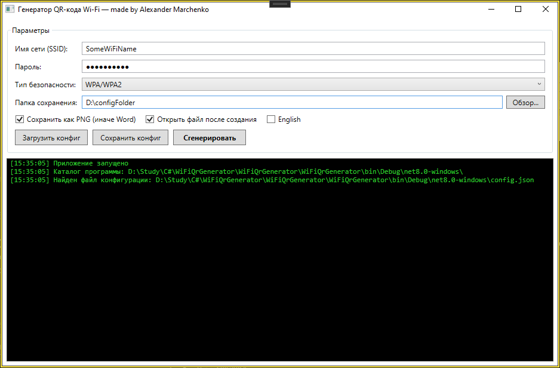

# WiFi QR Generator

A small WPF application that generates a QR code for your Wi-Fi network
and saves it either as a PNG image or as a Word (.docx) document
with the network name and password.

<p align="center">
  
</p>

---

## Features

- Enter SSID, password and security type (WPA/WPA2, WEP, nopass).
- Generate QR code and save it as:
  - **PNG** - QR code plus the network name and password below it.
  - **Word (.docx)** - centered QR image with network name and password.
- Choose the output folder (default: the folder with the executable).
- Optionally open the generated file right after creation.
- Colored log window:
  - green - normal messages
  - yellow - warnings
  - red - errors
- All exceptions are caught and shown in the log; the app never crashes.
- Two UI languages: **Russian** and **English**, switchable at runtime.
- Configuration saved to JSON:
  - window size and state
  - save folder
  - SSID, password, security type
  - output format, open-after-generation, language
- Load / save multiple configuration files via file dialogs.
- Automatic config load on startup and silent auto-save on exit.
- On startup the app checks whether it can write to its own folder
  and warns the user if not.
- Resizable window with sensible minimum size.

---

## Requirements

- Windows 10 / 11
- [.NET 8 SDK](https://dotnet.microsoft.com/download/dotnet/8.0) (to build)
- .NET 8 Desktop Runtime (to run a published build)

---

## Building

```bash
git clone https://github.com/<your-username>/WiFiQrGenerator.git
cd WiFiQrGenerator
dotnet build -c Release